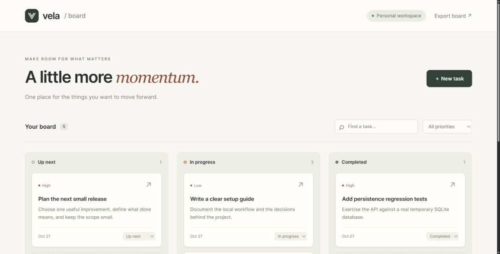

# Vela Board

**A quiet workspace for the next thing.**

A working, single-user task board built with React and TypeScript, an Express API, and SQLite. Create a task, move it from _Up next_ to _In progress_ to _Completed_, and pick up where you left off after restarting the app.



## Try it locally

Requires **Node.js 24 or later** and npm. No account, cloud service, API key, or external database is needed.

```sh
npm ci
npm run dev
```

Open **http://127.0.0.1:4310**. The board starts empty; the screenshot uses example tasks added through the interface.

For the production build:

```sh
npm run build
npm start
```

## What works

- Create, edit, and delete tasks with notes and three priority levels.
- Move tasks between columns using accessible status controls.
- Search titles and notes; filter by priority.
- Persist changes to a local SQLite database.
- Export the board as a versioned JSON file.
- Reject stale updates and deletes instead of overwriting newer edits from another tab.
- Display validation, connection, and save errors without clearing the open editor.
- Use the board on narrow screens with stacked columns and larger touch targets.

## Engineering choices

```text
React UI → same-origin JSON API → validated inputs → prepared SQL → SQLite
```

The API owns all durable data. Zod validates request bodies; SQLite uses parameterized statements and a checked status/priority schema. Each task carries an integer version. Writes include the version the editor loaded, and the database updates only a matching row. A conflict returns HTTP 409 and refreshes the board while retaining the user's text.

The server binds to `127.0.0.1`, restricts API hosts, rejects cross-origin writes, limits JSON request sizes, and disables caching for API responses. This is a **local personal workspace**, without accounts or authentication. Add authentication and a deployment-appropriate database before exposing it as a shared service. A local SQLite file is unsuitable for ephemeral/serverless storage.

Data lives in `.data/board.sqlite` (ignored by Git). Set `VELA_DATA_DIR` to choose another local directory and `PORT` to change the listening port. Back up the whole data directory while the server is stopped. The JSON export is for portability and inspection; an import flow is not implemented.

## Code map

| Path                | Responsibility                                              |
| ------------------- | ----------------------------------------------------------- |
| `src/App.tsx`       | Board, editor, search, filters, request and conflict states |
| `src/styles.css`    | Responsive layout, typography, focus and motion states      |
| `src/types.ts`      | Frontend task contract and status labels                    |
| `server/app.ts`     | HTTP routes, input validation, origin checks and errors     |
| `server/store.ts`   | SQLite schema, prepared queries and version checks          |
| `tests/api.test.ts` | Real HTTP and database regression tests                     |

## Verify

```sh
npm run check
```

Tests cover the CRUD cycle, missing records, stale edits and deletes, input boundaries, malformed and oversized requests, cross-origin writes, database reopening, and SQL-looking text stored as ordinary content. The build runs TypeScript checking and Vite's production compilation. GitHub Actions repeats the checks on Node 24.

## Scope

Created as a small public portfolio demo in October 2026. This repository is self-contained; it does not include code or data from private applications. The interface uses system fonts and an original SVG mark. Libraries retain their respective licenses.

Licensed under [Apache 2.0](LICENSE).
